# DocClear — Master Implementation Plan & Production Architecture (Next.js PWA)

**Course:** IT8530 Advanced Mobile Application Solutions  
**Framework:** Next.js 14+ (App Router) + React + TypeScript + Tailwind CSS  
**PWA Layer:** Serwist / Next.js Web App Manifest (`app/manifest.ts`)  
**Client Multimedia:** Native `<input capture="environment">` + Tesseract.js + Web Speech API  
**BFF Layer:** Next.js Route Handlers (`app/api/analyse/route.ts`) interfacing with EduStack Lite  
**Target:** Assessments 1 (60 marks), 2 (90 marks), and 3 (150 marks)

---

## 1. Executive Architecture Overview

DocClear is a mobile-first, highly accessible Progressive Web Application (PWA). It empowers users to understand complex documents (legal leases, tenancy agreements, medical statements, government notices) by capturing or uploading document images, performing privacy-first client-side OCR, reviewing and correcting text, submitting it to the Next.js BFF for plain-language simplification, comparing versions side-by-side, and listening via the Web Speech API.

```mermaid
flowchart TD
    subgraph Client["DocClear PWA Client (Next.js App Router + React + TypeScript)"]
        UI["Accessible Mobile-First UI (WCAG 2.2 AA)"]
        Cam["Native Camera / File Capture (<input capture='environment'>)"]
        OCR["Client-Side OCR (Tesseract.js - Privacy-First)"]
        Review["Text Review & Verification Interface (FR-05)"]
        Comp["Side-by-Side Comparison (Original vs Simplified)"]
        TTS["Speech Controller (Web Speech API speechSynthesis)"]
        HCI["Interactive Evaluation Dashboard (/evaluate)"]
    end

    subgraph BFF_Tier["Next.js Route Handlers (BFF Tier)"]
        RouteHandler["/app/api/analyse/route.ts"]
        MockEngine["Mock Simplification Engine (Phase 1 / A2)"]
    end

    subgraph Orchestration["Enterprise Orchestration Layer (EduStack Lite)"]
        Gateway["OpenClaw Gateway (:18789)"]
        Shim["Inference Shim (:8000)"]
        LLM["Language Model (Ollama / Cloud LLM)"]
    end

    Cam --> OCR
    OCR --> Review
    Review -->|POST /api/analyse| RouteHandler
    RouteHandler -.->|Development / Prototype| MockEngine
    RouteHandler -->|Live Orchestration| Gateway
    Gateway --> Shim
    Shim --> LLM
    RouteHandler -->|Structured Simplification JSON| Comp
    Comp --> TTS
    UI -.-> HCI
```



---

## 2. Standardized Repository & Folder Structure

The application strictly adheres to the modular architecture below:

```text
docclear/
├── app/
│   ├── layout.tsx                          # Root layout with accessibility providers & skip-link
│   ├── page.tsx                            # Dashboard: Document capture & upload
│   ├── globals.css                         # Tailwind CSS & accessible theme variables
│   ├── manifest.ts                         # PWA Web App Manifest metadata
│   ├── review/
│   │   └── page.tsx                        # Editable OCR text inspection & correction screen
│   ├── comparison/
│   │   └── page.tsx                        # Side-by-side comparison & audio playback screen
│   ├── evaluate/
│   │   └── page.tsx                        # HCI Evaluation Dashboard (interactive SUS & heuristic forms)
│   └── api/
│       └── analyse/
│           └── route.ts                    # BFF Route Handler (mock for A2, live proxy for A3)
│
├── components/
│   ├── ui/
│   │   ├── Button.tsx                      # Accessible button (min 48px touch target, focus visible)
│   │   ├── Card.tsx                        # High-contrast surface card
│   │   └── Alert.tsx                       # WCAG alert banner (role="alert")
│   ├── capture/
│   │   └── CameraCapture.tsx               # Native file input with mobile camera trigger
│   ├── review/
│   │   └── TextReviewEditor.tsx            # Accessible multiline text editor with word count
│   ├── comparison/
│   │   ├── ComparisonView.tsx              # Split / tabbed layout for original vs simplified
│   │   └── DisclaimerBanner.tsx            # Mandatory AI verification warning
│   ├── audio/
│   │   └── SpeechPlayer.tsx                # Web Speech API controls (play, pause, rate)
│   └── evaluation/
│       ├── SUSForm.tsx                     # 10-item System Usability Scale calculator
│       └── HeuristicChecklist.tsx          # Nielsen & WCAG interactive checklist
│
├── lib/
│   ├── ocr.ts                              # Tesseract.js client-side OCR pipeline
│   ├── speech.ts                           # window.speechSynthesis wrapper
│   ├── readability.ts                      # Flesch-Kincaid grade level calculator
│   ├── validation.ts                       # Input schemas & payload sanitizers
│   └── errors.ts                           # Standardized error definitions & recovery codes
│
├── services/
│   ├── simplification.ts                   # Client-side API caller for /api/analyse
│   └── edustack-client.ts                  # Server-side connector to EduStack Lite orchestration
│
├── types/
│   ├── document.ts                         # Document session state & OCR types
│   ├── api.ts                              # BFF request & response payloads
│   └── evaluation.ts                       # SUS & heuristic scoring types
│
├── tests/
│   ├── components/                         # UI component accessibility & unit tests
│   ├── api/                                # Route Handler contract tests
│   └── e2e/                                # End-to-end browser user journey tests
│
├── docs/
│   ├── requirements.md                     # Assessment 1 & 2 requirements traceability
│   ├── architecture.md                     # System architecture & network boundary doc
│   ├── test-plan.md                        # Verification plan & test cases
│   └── hci-evaluation.md                   # Usability evaluation protocol & results
│
├── public/
│   └── icons/                              # PWA icons (192x192, 512x512)
├── .env.example                            # Template for environment variables
├── .gitignore
├── package.json
├── package-lock.json
├── tsconfig.json
└── README.md
```

---

## 3. Strict Accessibility Standards (WCAG 2.2 AA)

1. **Touch Targets:** Minimum interactive target size of `48 x 48 px` on all buttons, links, and inputs.
2. **Color Contrast:** Minimum 4.5:1 for body copy and 3:1 for large text/icons against backgrounds. Focus rings use high-visibility 2px solid outlines with `#1D4ED8` offset.
3. **Semantic HTML & Screen Reader Support:**
   - Dedicated `<main id="main-content">` with a prominent "Skip to content" link.
   - Live region (`aria-live="polite"`) for OCR scanning progress and network loading states.
   - Descriptive `aria-label` attributes on icon-only and media controls.
4. **Cognitive Load:** One primary task per screen, plain-language error descriptions with immediate recovery actions.

---

## 4. Phase-by-Phase Step Breakdown

* **Step 1:** Scaffolding the Next.js project with Tailwind CSS + creating the accessible Root Layout and Dashboard (`/app/layout.tsx` & `/app/page.tsx`).
* **Step 2:** Implementing client-side OCR with Tesseract.js and creating the Editable Text Review screen (`/app/review/page.tsx`).
* **Step 3:** Implementing the Next.js BFF Route Handler (`/app/api/analyse/route.ts`) returning structured simplification payloads.
* **Step 4:** Building the Side-by-Side Comparison screen (`/app/comparison/page.tsx`) with Web Speech API TTS player.
* **Step 5:** Creating the Interactive HCI Evaluation Dashboard (`/app/evaluate/page.tsx`) for Assessment 2 scoring.
* **Step 6:** Adding PWA manifest and service worker configuration for offline capability.
